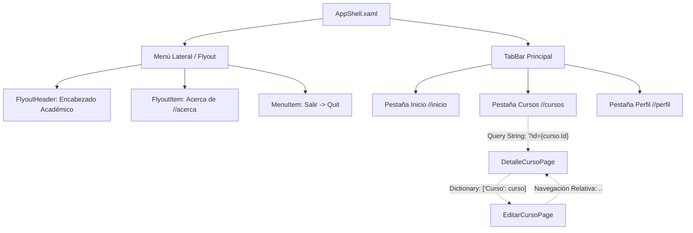

# Presentación 4 – Navegación con Shell (.NET MAUI)

> **Catálogo de Cursos** – Aplicación móvil desarrollada con .NET MAUI y C# implementando la arquitectura de navegación completa basada en Shell: Menú Lateral (Flyout), Barra de Pestañas (TabBar), navegación jerárquica con rutas absolutas y relativas, paso de parámetros primitivos por Query String y transferencia de objetos complejos mediante `IQueryAttributable`.

---

## 📋 Datos del Estudiante y de la Asignatura

| Campo | Detalle |
| :--- | :--- |
| **Estudiante** | Jonathan Rivera |
| **Correo Institucional** | jonithinx@gmail.com |
| **Asignatura** | Programación Móvil II |
| **Docente** | Cátedra de Programación Móvil |
| **Entorno de Desarrollo** | .NET 10.0 / .NET MAUI / C# 13 / Visual Studio 2026 |
| **Plataformas Soportadas** | Android, Windows, iOS, macOS (MacCatalyst) |

---

## 🗺️ Mapa Detallado de Rutas Shell

La aplicación organiza su navegación mediante un esquema estructurado en tres niveles:



### 1. Rutas Fijas (TabBar & Flyout)
* **`//inicio`** (`InicioPage`): Pantalla de bienvenida con métricas académicas (total de cursos y créditos) y accesos directos.
* **`//cursos`** (`CursosPage`): Catálogo principal con `CollectionView` de cursos en tarjetas interactivas.
* **`//perfil`** (`PerfilPage`): Perfil del estudiante con información académica institucional.
* **`//acerca`** (`AcercaPage`): Elemento del menú Flyout con información de la versión y arquitectura de la app.
* **Opción Salir**: `MenuItem` en el menú Flyout que invoca `Application.Current.Quit()`.

### 2. Rutas Registradas Dinámicamente (`Routing.RegisterRoute`)
Registradas en el constructor de [AppShell.xaml.cs](file:///c:/Users/jonit/source/repos/CatalogoCursosShell/CatalogoCursosShell/AppShell.xaml.cs):
```csharp
Routing.RegisterRoute(nameof(DetalleCursoPage), typeof(DetalleCursoPage));
Routing.RegisterRoute(nameof(EditarCursoPage), typeof(EditarCursoPage));
```

---

## 🔄 Estructura de Paso de Parámetros

La aplicación demuestra de manera rigurosa las dos estrategias de transferencia de información en .NET MAUI Shell:

### 1. Parámetro Primitivo por Query String (De `CursosPage` a `DetalleCursoPage`)
* **Emisión**: Al seleccionar una tarjeta o pulsar "Ver Detalle", se envía el identificador numérico concatenado a la URL de navegación:
  ```csharp
  await Shell.Current.GoToAsync($"{nameof(DetalleCursoPage)}?id={curso.Id}");
  ```
* **Recepción**: `DetalleCursoPage` declara el atributo `[QueryProperty]` para mapear automáticamente el parámetro `"id"`:
  ```csharp
  [QueryProperty(nameof(CursoId), "id")]
  public partial class DetalleCursoPage : ContentPage
  {
      public string CursoId
      {
          get => _cursoId.ToString();
          set
          {
              if (int.TryParse(value, out int id))
              {
                  _cursoId = id;
                  CargarCurso(id);
              }
          }
      }
      ...
  }
  ```

### 2. Objeto Completo mediante Diccionario e `IQueryAttributable` (De `DetalleCursoPage` a `EditarCursoPage`)
* **Emisión**: Desde el botón "Editar Curso", se empaqueta el objeto `Curso` completo dentro de un `Dictionary<string, object>`:
  ```csharp
  var parametros = new Dictionary<string, object>
  {
      { "Curso", cursoActual }
  };
  await Shell.Current.GoToAsync(nameof(EditarCursoPage), parametros);
  ```
* **Recepción**: `EditarCursoPage` implementa la interfaz `IQueryAttributable`, recibiendo el diccionario en una sola llamada segura sin problemas de serialización:
  ```csharp
  public partial class EditarCursoPage : ContentPage, IQueryAttributable
  {
      public void ApplyQueryAttributes(IDictionary<string, object> query)
      {
          if (query.TryGetValue("Curso", out var cursoObj) && cursoObj is Curso curso)
          {
              _cursoRecibido = curso;
              // Inicialización de campos del formulario
          }
      }
      ...
  }
  ```

### 3. Navegación Relativa de Retorno
Tras guardar o cancelar en el formulario de edición, se regresa a la pantalla anterior del stack de navegación:
```csharp
await Shell.Current.GoToAsync("..");
```
Al regresar, `DetalleCursoPage.OnAppearing()` y `CursosPage.OnAppearing()` recargan los datos desde `CursoService` para reflejar instantáneamente cualquier cambio.

---

## 🏛️ Estructura del Proyecto

```
CatalogoCursosShell/
├── Models/
│   └── Curso.cs                     # Modelo de dominio de la entidad Curso
├── Services/
│   └── CursoService.cs              # Servicio en memoria con 6 cursos reales y métodos CRUD
├── Views/
│   ├── InicioPage.xaml (.cs)        # Página de inicio con métricas y resumen
│   ├── CursosPage.xaml (.cs)        # Catálogo con CollectionView y Query String
│   ├── DetalleCursoPage.xaml (.cs)  # Detalle del curso con [QueryProperty] y navegación a edición
│   ├── EditarCursoPage.xaml (.cs)   # Formulario de edición con IQueryAttributable y retorno relativo
│   ├── PerfilPage.xaml (.cs)        # Perfil del alumno y datos de matrícula
│   └── AcercaPage.xaml (.cs)        # Información institucional y técnica de la aplicación
├── AppShell.xaml (.cs)              # Estructura Shell (Flyout, TabBar y registro de rutas)
├── App.xaml (.cs)                   # Inicialización de la aplicación
├── MauiProgram.cs                   # Configuración del host y fuentes
└── CatalogoCursosShell.csproj       # Definición de dependencias y multi-targeting .NET MAUI
```

---

## 📸 Evidencias de Ejecución (Capturas de Pantalla)

> Reemplaza los siguientes enlaces con las capturas tomadas de tu dispositivo móvil o emulador:

| Pestaña de Inicio | Catálogo de Cursos | Menú Lateral (Flyout) |
| :---: | :---: | :---: |
|  |  |  |

| Detalle del Curso | Formulario de Edición | Perfil del Estudiante |
| :---: | :---: | :---: |
|  |  |  |

---

## 🎥 Video Demostrativo

- 🔗 **Enlace al video:** [Ver Video en YouTube / OneDrive / Google Drive](https://youtu.be/TU_ENLACE_AQUI)
- **Duración estimada:** 2 - 3 minutos.
- **Aspectos mostrados en la demo:**
  1. Apertura del menú lateral Flyout y navegación a "Acerca de".
  2. Uso del `TabBar` para navegar entre Inicio, Cursos y Perfil.
  3. Selección de un curso con paso de parámetro `?id=...` y visualización de detalles.
  4. Navegación hacia `EditarCursoPage` pasando el objeto con diccionario.
  5. Modificación de datos (nombre, docente, créditos, descripción) y guardado con retorno relativo (`..`).
  6. Comprobación de persistencia y actualización inmediata en detalle y catálogo.
  7. Prueba del `MenuItem` "Salir" para cerrar la aplicación.

---

## 🚀 Cómo Compilar y Ejecutar

1. Clonar el repositorio:
   ```bash
   git clone <URL_DEL_REPOSITORIO>
   cd CatalogoCursosShell
   ```
2. Restaurar dependencias:
   ```bash
   dotnet restore
   ```
3. Ejecutar en Windows:
   ```bash
   dotnet build -t:Run -f net10.0-windows10.0.19041.0
   ```
4. O abrir con Visual Studio 2022/2026 y seleccionar el dispositivo / emulador de destino (Android Emulator, Windows Machine, iOS Simulator).
